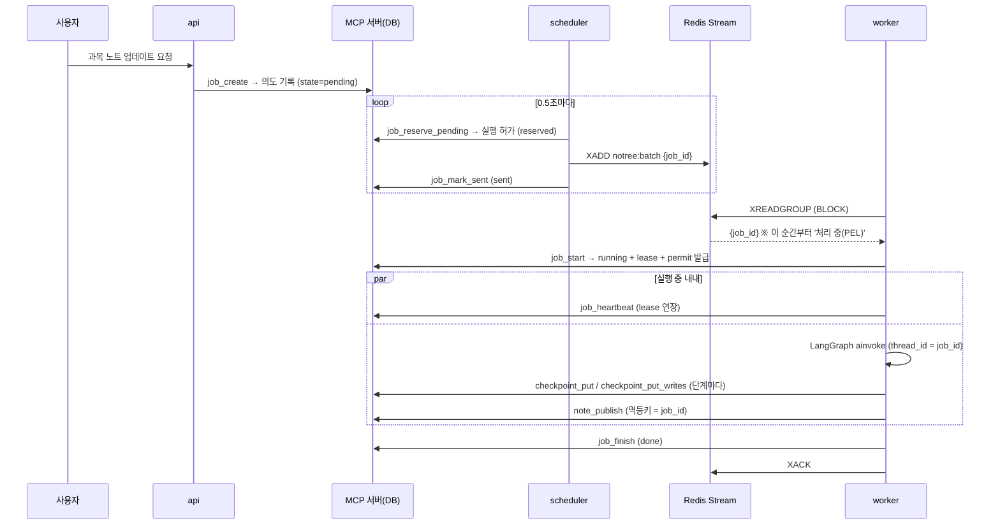

# worker 실행 흐름

에이전트 서빙 플랫폼(LangGraph Agent Server)을 쓰지 않고, 설계서 v0.4.1대로
**api → scheduler(배정기) → Redis Streams → worker**를 직접 짰을 때 작업 하나가 어떻게 흘러가는지 정리한 문서입니다.
과목 노트 업데이트(LangGraph) 작업을 예로 듭니다. 코드 구조는 [worker-structure.md](worker-structure.md)를 보세요.

## 1. 등장하는 프로세스

| 프로세스 | 코드 | 하는 일 | DB 접근 |
|---|---|---|---|
| 내부 MCP 서버 | `notree/mcp_server/` | DB를 혼자 소유. 작업·체크포인트·발행 도구 제공 | 직접 |
| api | (흉내: `notree/dev/enqueue.py`) | 사용자 요청을 받아 **의도(intent)** 만 기록 | MCP 경유 ※ |
| scheduler | `notree/scheduler/` | 배정기: 의도 → 실행 허가 → Redis에 `job_id`만 넣음. 주기 작업: 누락 복구·체크포인트 정리 | MCP 경유 ※ |
| worker-qa / worker-rt / worker-batch | `notree/worker/` | Redis에서 받아 핸들러 실행, 체크포인트 저장, 발행, ACK | **MCP만** |
| Redis 7 | — | `notree:qa`(Q&A·채점), `notree:rt`(실시간 요약), `notree:batch` Stream, consumer group `workers` | — |

※ 실제 설계에서 api와 scheduler는 PG에 직접 붙습니다. 이 PoC는 DB를 MCP 서버 하나에 모아 두어서 MCP 도구로 흉내 냈습니다.
**worker가 DB에 직접 붙지 않는다**는 원칙만은 설계서 그대로입니다.

## 2. 정상 흐름



상태가 두 군데에서 따로 움직입니다.

| 단계 | DB의 작업 상태 (`jobs.state`) | Redis 메시지 |
|---|---|---|
| api 요청 | `pending` (의도) | 없음 |
| 배정기 | `reserved` (실행 허가) → `sent` | `XADD`로 생성 |
| worker가 받음 | `running` + `lease_owner`, `lease_until` | 그 worker의 처리 중 목록(PEL)에 들어감 |
| 실행 중 | `lease_until`이 heartbeat마다 늘어남 | 그대로 |
| 끝 | `done` 또는 `failed` | `XACK`로 PEL에서 빠짐 |
| 일시적 실패 | `sent`로 되돌림 (lease 반납) | ACK 안 함 → 재배송 기준 뒤 다시 꺼내짐 |

**DB 상태가 진실이고, Redis는 "누가 이걸 해야 한다"는 알림**이라고 보면 됩니다.
그래서 메시지에는 `job_id`만 들어가고, 실제 입력은 worker가 `job_start`로 DB에서 읽습니다.

## 3. worker 한 바퀴

```
while 종료 신호가 없으면:
  0) 빈 슬롯 대기 : 슬롯이 비거나 종료 신호가 오면 깨어남 (꽉 찬 채로 종료 신호를 놓치지 않음)
  1) XAUTOCLAIM   : ACK 없이 재배송 기준 넘게 방치된 메시지가 있으면 내 것으로 가져옴 (= 죽은 worker의 작업)
  2) XREADGROUP   : 없으면 새 메시지 대기
  3) 이미 이 worker가 실행 중인 job이면 손대지 않음
  4) job_start    : ├ done / failed  → 이미 끝난 작업. XACK만 하고 넘어감
                    ├ leased         → lease가 살아 있음(같은 worker라도). 손대지 않음
                    └ started        → lease + permit(실행 세대 포함) 획득
  5) 핸들러        : (과목 노트) LangGraph 상태를 먼저 조회
                    ├ 체크포인트 없음                → 처음부터 ainvoke(입력)
                    ├ 체크포인트 있고 남은 노드 있음   → ainvoke(None) = 이어하기
                    └ 그래프는 이미 끝남              → 마무리만
                    실행 중에는 heartbeat마다 job_heartbeat + Redis 방치 시간 초기화(XCLAIM JUSTID)
  6) 결과별        : 성공 job_finish / 영구 실패·한도 초과·마감 초과 job_fail → **확정 응답을 받은 뒤에만** XACK
                    일시적 실패 job_release (ACK 안 함)
                    확정을 못 받으면(장애·실행권 없음) ACK 안 함 → 재배송으로 다시 처리
```

코드: `notree/worker/loop.py`의 `Worker._next`, `Worker.process`, `notree/worker/handlers/course_update.py`.

## 4. 죽거나 느릴 때

| 상황 | 무슨 일이 일어나나 | 결과 |
|---|---|---|
| **extract 도중 죽음** | ACK·heartbeat가 멈춤 → lease 만료 → 메시지가 재배송 기준 넘게 방치됨 → 다른 worker가 `XAUTOCLAIM` → `job_start` 성공 → 체크포인트에서 이어감 | 이미 끝난 extract는 다시 안 부름 |
| **merge 도중 `kill -9`** | 위와 같음. 마지막 체크포인트가 "extract 끝, merge 남음"이라 merge부터 | 실제 SIGKILL로 확인 |
| **발행 직후 죽음** (DB엔 저장됐는데 ACK 전) | 넘겨받은 worker가 publish를 다시 실행 → 같은 멱등키라 `note_publish`가 `duplicate: true` | 노트는 한 번만 저장 |
| **느리지만 살아 있음** | heartbeat마다 Redis 방치 시간을 초기화하므로 재배송 대상이 되지 않음. 그래도 넘어가면 `job_start`가 `leased`로 거절 | 원래 worker가 끝까지 처리 (같은 worker가 자기 메시지를 다시 가져가는 것도 막음) |
| **완료 기록 실패** | `job_finish`를 몇 번 다시 시도, 확정 못 받으면 ACK 안 함 → lease 만료 뒤 재배송 → 다시 실행(멱등) → 완료 | DB `running`인데 메시지만 사라지는 일이 없음 |
| **lease를 잃은 실행자가 늦게 저장** | 쓰기 도구가 같은 트랜잭션에서 permit의 소유자·실행 세대를 DB와 대조 → `permit_invalid` | 넘겨받은 실행만 저장 가능 |
| **일시적 오류** | lease 반납 후 재배송 → 시도 한도까지 재시도 | 한도 넘으면 실패 확정 (다시 시도 가능) |
| **배정기가 허가 직후 죽음** | DB는 `reserved`인데 Redis 메시지 없음 → scheduler 주기 작업이 30초 뒤 다시 XADD | 실행됨 |

"느리지만 살아 있음"이 lease와 heartbeat를 두는 이유입니다. Redis만으로는 "죽었다"와 "느리다"를 구분하지 못합니다.
Redis가 아는 건 "ACK가 오래 안 왔다"뿐이라서, 살아 있는지는 DB의 lease로 판단합니다.

## 5. 역할 분담: LangGraph가 하는 것 / 우리가 짜는 것

| LangGraph 라이브러리 | 우리 코드 |
|---|---|
| 노드 실행 순서, `Send` 병렬, 조건부 분기 | Redis에서 작업 받기, ACK, 재배송(`XAUTOCLAIM`) |
| 단계마다 체크포인트 저장 (`durability="sync"`) | 체크포인트를 MCP로 보내는 저장기 (`notree/worker/checkpointer.py`) |
| 병렬 노드의 부분 결과(pending writes) 보존 | lease · heartbeat · 실행 허가 (`job_*` 도구) |
| `ainvoke(None)` 한 줄로 이어하기 | 발행 멱등키, 이미 끝난 작업 판별, 재시도 한도, 마감 시각 |

## 6. 시간 값

확정 값은 [team-decisions.md](team-decisions.md) 2절. 규칙은 **heartbeat < lease < 재배송 기준**입니다.
재배송 기준이 lease보다 짧으면 죽은 worker의 lease가 아직 살아 있어서 이어받기가 매번 거절됩니다.
죽은 뒤 다른 worker가 이어받기까지 걸리는 시간 ≈ 재배송 기준 + worker 폴링 주기(최대 1초)입니다.

## 7. 돌려 보기

```powershell
uv run python -m notree.dev.takeover                    # worker-A가 extract 도중 죽고 worker-B가 체크포인트에서 이어감
uv run python -m notree.dev.takeover --die-at publish   # 발행 직후 죽음 → 중복 발행 없이 마무리
uv run pytest -q tests/test_takeover.py                 # 죽음 인계 · 발행 직후 죽음 · 느린 worker 보호
```

진짜 Redis와 별도 프로세스로 (`docker compose up -d`로 Redis를 띄운 뒤, 터미널 여러 개):

```powershell
uv run python -m notree.mcp_server --http                       # 1
uv run python -m notree.scheduler.allocator                     # 2
$env:NOTREE_FAKE_DELAY="5"; uv run python -m notree.worker --stream batch --name A   # 3
uv run python -m notree.worker --stream batch --name B          # 4
uv run python -m notree.dev.enqueue course_update sources=hello,big,world
```

3번은 가짜 LLM 호출이 5초씩 걸리게 띄운 것입니다. extract 로그가 찍힐 때 3번 창을 닫으면(진짜 죽음)
lease가 만료되고 재배송 기준(batch 90초)이 지난 뒤 4번이 이어받습니다. 빨리 보려면 `$env:NOTREE_BATCH_LEASE_SEC="6"`,
`$env:NOTREE_BATCH_CLAIM_IDLE_SEC="10"`을 1~4번 창 모두에 설정하세요.

`uv run python -m notree.dev.takeover` 실제 출력 (발췌):

```
  [17:17:36.305] batch-A    job           신규 op-83c782b0 [course_update] 시도 1/3
  [17:17:36.365] batch-A    extract       'hello' → 'HELLO'
  [17:17:36.365] batch-A    extract       'big' → 'BIG'
  [17:17:36.673] batch-A    💀             worker 프로세스 죽음 (ACK·완료 표시·lease 반납·heartbeat 없음)
  [17:17:40.401] batch-B    job           재배송 op-83c782b0 [course_update] 시도 2/3
  [17:17:40.415] batch-B    graph         체크포인트에서 이어감: 남은 노드=['extract'] 끝난 extract=['hello', 'big']
  [17:17:40.424] batch-B    extract       'world' → 'WORLD'
  [17:17:40.470] batch-B    publish       새 버전 저장: 'HELLO BIG WORLD!' [완료]
  [17:17:40.488] batch-B    done          op-83c782b0 완료 → XACK
```

## 8. 만들면서 알게 된 것

- **heartbeat는 이벤트 루프가 살아 있어야 돈다.** 노드 안에서 동기 함수로 오래 막으면(예: 동기 HTTP 호출)
  heartbeat 코루틴이 못 돌아 lease가 만료되고, 살아 있는데도 작업을 빼앗긴다.
  LLM 호출은 비동기 클라이언트로 하거나, 동기 노드는 스레드에서 돌게 둬야 한다
  (LangGraph는 동기 노드를 스레드에서 돌려 주므로 이 PoC는 괜찮았음).
- **heartbeat는 DB만이 아니라 Redis도 건드려야 한다.** 처음에는 DB의 lease만 연장해서, 오래 걸리는 작업이 Redis 입장에서는
  계속 '방치된 메시지'였다. 그 결과 다른 worker는 물론 **같은 worker도 자기 메시지를 다시 가져가 중복 실행**했다
  (외부 분석으로 발견, 재현 시 한 작업이 3번 시작됨). 지금은 heartbeat마다 `XCLAIM … JUSTID`로 방치 시간을 0으로 되돌린다.
- **"확정 전에는 ACK하지 않는다".** 완료 표시가 실패했는데 ACK하면 DB는 `running`, Redis에는 메시지가 없어 누구도 다시 처리하지 않는다.
- **서명된 permit ≠ 지금의 실행권.** 서명은 위조가 아님만 증명한다. 실행권은 쓰기 순간 DB(소유자·실행 세대)와 대조해야 한다.
- **lease 시각은 MCP 서버 시계 기준이다.** worker 시계가 틀려도 영향이 없다.
- **fakeredis에서는 `BLOCK`이 이벤트 루프를 멈춘다.** 그래서 데모·테스트에서는 막지 않고 0.2초 간격으로 폴링한다.
  진짜 Redis에서는 `BLOCK 1000`을 쓴다.
- **MCP를 HTTP로 바꿔도 호출 하나는 수 ms 수준**이었다 (같은 PC, 평균 약 5.5ms).
  과목 노트 작업 한 번에 MCP 호출이 30회 안팎이므로 LLM 호출 시간에 비하면 무시할 만하다.

## 9. 설계서 대비 아직 없는 것

- 배정기의 사용자·과목별 동시 상한·예산 검사 (지금은 대기 중인 의도를 전부 허가)
- 실제 핸들러 (`live_summary`, `qa`, `grading`, `final_note`는 스텁)
- MCP 서버의 PG + RLS 구현 (지금은 SQLite, 사용자 ID는 permit에서 꺼내 저장만 함)
