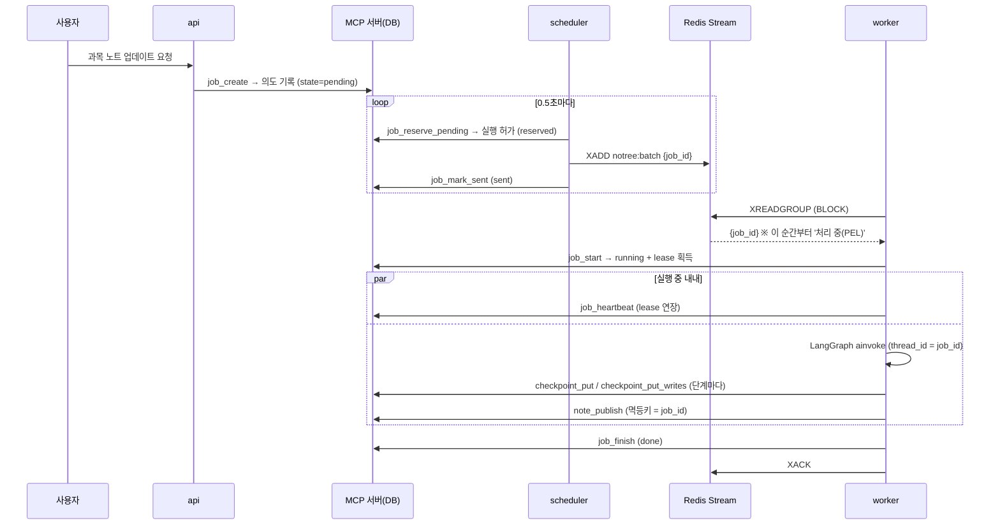

# worker 실행 흐름

에이전트 서빙 플랫폼(LangGraph Agent Server)을 쓰지 않고, 설계서 v0.4.1대로
**api → scheduler(배정기) → Redis Streams → worker**를 직접 짰을 때 작업 하나가 어떻게 흘러가는지 정리한 문서입니다.
과목 노트 업데이트(LangGraph) 작업을 예로 듭니다.

## 1. 등장하는 프로세스

| 프로세스 | 파일 | 하는 일 | DB 접근 |
|---|---|---|---|
| 내부 MCP 서버 | `mcp_server.py` | DB를 혼자 소유. 작업·체크포인트·발행 도구 제공 | 직접 |
| api | `api.py` | 사용자 요청을 받아 **의도(intent)** 만 기록 | MCP 경유 ※ |
| scheduler (배정기) | `scheduler.py` | 의도 → 실행 허가 → Redis에 `job_id`만 넣음 | MCP 경유 ※ |
| worker-batch | `worker.py` | Redis에서 받아 실행, 체크포인트 저장, 발행, ACK | **MCP만** |
| Redis 7 | — | `notree:batch` Stream, consumer group `workers` | — |

※ 실제 설계에서 api와 scheduler는 PG에 직접 붙습니다. 이 PoC는 DB를 MCP 서버 하나에 모아 두어서 MCP 도구로 흉내 냈습니다.
**worker가 DB에 직접 붙지 않는다**는 원칙만은 설계서 그대로입니다.

## 2. 정상 흐름



상태가 두 군데에서 따로 움직입니다.

| 단계 | DB의 작업 상태 (`jobs.state`) | Redis 메시지 |
|---|---|---|
| api 요청 | `pending` (의도) | 없음 |
| 배정기 | `reserved` (실행 허가) → `sent` | `XADD`로 생성 |
| worker가 받음 | `running` + `lease_owner`, `lease_until` | 그 worker의 처리 중 목록(PEL)에 들어감 |
| 실행 중 | `lease_until`이 heartbeat마다 늘어남 | 그대로 |
| 끝 | `done` | `XACK`로 PEL에서 빠짐 |

**DB 상태가 진실이고, Redis는 "누가 이걸 해야 한다"는 알림**이라고 보면 됩니다.
그래서 메시지에는 `job_id`만 들어가고, 실제 입력은 worker가 `job_start`로 DB에서 읽습니다.

## 3. worker 한 바퀴

```
while 안 멈췄으면:
  1) XAUTOCLAIM   : ACK 없이 CLAIM_IDLE 넘게 방치된 메시지가 있으면 내 것으로 가져옴 (= 죽은 worker의 작업)
  2) XREADGROUP   : 없으면 새 메시지 대기
  3) job_start    : ├ done    → 이미 끝난 작업. XACK만 하고 넘어감
                    ├ leased  → 다른 worker가 살아서 하는 중. 손대지 않음
                    └ ok      → lease 획득
  4) 핸들러        : LangGraph 상태를 먼저 조회
                    ├ 체크포인트 없음        → 처음부터 ainvoke(입력)
                    ├ 체크포인트 있고 남은 노드 있음 → ainvoke(None)  = 이어하기
                    └ 그래프는 이미 끝남      → 마무리만
                    실행 중에는 HEARTBEAT마다 job_heartbeat
  5) job_finish → XACK
```

코드: `worker.py`의 `run_worker`, `handle`, `course_update`.

## 4. 죽거나 느릴 때

| 상황 | 무슨 일이 일어나나 | 결과 |
|---|---|---|
| **extract 도중 죽음** | ACK·heartbeat가 멈춤 → lease 만료 → 메시지가 `CLAIM_IDLE` 넘게 방치됨 → 다른 worker가 `XAUTOCLAIM` → `job_start` 성공 → 체크포인트에서 이어감 | 이미 끝난 extract는 다시 안 부름 |
| **merge 도중 `kill -9`** | 위와 같음. 마지막 체크포인트가 "extract 끝, merge 남음"이라 merge부터 | 실제 SIGKILL로 확인 |
| **발행 직후 죽음** (DB엔 저장됐는데 ACK 전) | 넘겨받은 worker가 publish를 다시 실행 → 멱등키로 `note_publish`가 거절 | 노트는 한 번만 저장 |
| **느리지만 살아 있음** | 메시지가 오래 방치돼 다른 worker가 `XAUTOCLAIM`은 함. 하지만 `job_start`가 "lease 3.4초 남음"으로 거절 | 원래 worker가 끝까지 처리 |
| **진짜 오류(예외)** | ACK 안 함 → 재배송 | 이 PoC에는 재시도 한도·dead letter가 없음 (아래 7절) |

마지막 경우가 lease와 heartbeat를 두는 이유입니다. Redis만으로는 "죽었다"와 "느리다"를 구분하지 못합니다.
Redis가 아는 건 "ACK가 오래 안 왔다"뿐이라서, 살아 있는지는 DB의 lease로 판단합니다.

## 5. 역할 분담: LangGraph가 하는 것 / 우리가 짜는 것

| LangGraph 라이브러리 | 우리 코드 |
|---|---|
| 노드 실행 순서, `Send` 병렬, 조건부 분기 | Redis에서 작업 받기, ACK, 재배송(`XAUTOCLAIM`) |
| 단계마다 체크포인트 저장 (`durability="sync"`) | 체크포인트를 MCP로 보내는 저장기 (`mcp_saver.py`) |
| 병렬 노드의 부분 결과(pending writes) 보존 | lease · heartbeat · 실행 허가 (`job_*` 도구) |
| `ainvoke(None)` 한 줄로 이어하기 | 발행 멱등키, 이미 끝난 작업 판별 |

## 6. 시간 값

| 값 | 설계서 | 데모 | 규칙 |
|---|---|---|---|
| lease | 60초 | 4초 | |
| heartbeat | 20초 | lease/3 | lease보다 충분히 짧게 (3번에 1번 놓쳐도 버팀) |
| 재배송 기준(방치 시간) | 미정 | 6초 | **lease보다 길게.** 짧으면 죽은 worker의 lease가 아직 살아 있어 매번 거절됨 |

환경변수 `NOTREE_LEASE_SEC`, `NOTREE_CLAIM_IDLE_MS`로 바꿀 수 있습니다.
죽은 뒤 다른 worker가 이어받기까지 걸리는 최악의 시간 ≈ 재배송 기준 + worker 폴링 주기입니다.
설계서 값이면 1분 이상 걸리므로, 과목 노트처럼 오래 걸리는 batch 작업에만 맞는 값입니다.

## 7. 돌려 보기

```powershell
python demo.py                          # Redis 없이 (fakeredis). api·scheduler·worker A·B를 한 프로세스에서
python demo.py --die-at publish         # 발행 직후 죽는 경우
python demo.py --die-at none            # 아무도 안 죽는 경우
pytest -q tests/test_worker.py          # 죽음 인계 · 중복 발행 방지 · 느린 worker 보호
```

진짜 Redis와 별도 프로세스로 (`docker compose up -d`로 Redis를 띄운 뒤, 터미널 4개):

```powershell
python mcp_server.py --http                     # 1
python scheduler.py                             # 2
python worker.py --name A --die-at extract:world  # 3
python worker.py --name B                       # 4
python api.py --lectures hello,big,world        # 요청
```

일부러 죽이는 대신 진짜로 창을 닫아 보려면, 3번을 `$env:NOTREE_FAKE_DELAY="5"; python worker.py --name A`로 띄워
가짜 LLM 호출이 5초씩 걸리게 한 뒤 extract 로그가 찍힐 때 창을 닫으면 됩니다.

```powershell


`python demo.py` 실제 출력 (발췌):

```
── 2. 사용자 요청 → api가 의도 기록 → scheduler가 큐에 넣음 → worker-A가 받음
  [22:15:28.107] api        request    과목 노트 업데이트 요청 → 의도 기록 job=op-29dc8f0a
  [22:15:28.321] scheduler  allocator  의도 op-29dc8f0a → 실행 허가(reserved)
  [22:15:28.332] scheduler  allocator  XADD notree:batch 1791983728321-0 → 전송 완료(sent)
  [22:15:28.396] worker-A   redis      신규(XREADGROUP) 메시지 1791983728321-0
  [22:15:28.411] worker-A   permit     실행 허가 + lease 4초 획득 (시도 1회째)
  [22:15:28.473] worker-A   extract    'hello' → 'HELLO'
  [22:15:28.473] worker-A   extract    'big' → 'BIG'
  [22:15:28.782] worker-A   💀          강제 중단: extract:world → 프로세스 죽음

── 3. worker-A 죽음 → worker-B 기동. ACK 없는 메시지가 6초 방치되길 기다림
  [22:15:34.586] worker-B   redis      재배송(XAUTOCLAIM) 메시지 1791983728321-0
  [22:15:34.714] worker-B   permit     실행 허가 + lease 4초 획득 (시도 2회째, 이전 담당=worker-A)
  [22:15:34.726] worker-B   handler    체크포인트에서 이어감: 남은 노드=['extract']  이미 끝난 extract=['hello', 'big']
  [22:15:34.736] worker-B   extract    'world' → 'WORLD'
  [22:15:34.780] worker-B   publish    새 버전 저장: 'HELLO BIG WORLD!' [완료]
  [22:15:34.797] worker-B   redis      job_finish → XACK
```

## 8. 만들면서 알게 된 것

- **heartbeat는 이벤트 루프가 살아 있어야 돈다.** 노드 안에서 동기 함수로 오래 막으면(예: 동기 HTTP 호출)
  heartbeat 코루틴이 못 돌아 lease가 만료되고, 살아 있는데도 작업을 빼앗긴다.
  LLM 호출은 비동기 클라이언트로 하거나, 동기 노드는 스레드에서 돌게 둬야 한다
  (LangGraph는 동기 노드를 스레드에서 돌려 주므로 이 PoC는 괜찮았음).
- **`XAUTOCLAIM`은 lease와 상관없이 메시지 소유권을 옮긴다.** 그래서 느린 worker의 메시지를 다른 worker가 계속 가져갔다가
  `job_start`에서 거절당하는 일이 재배송 기준마다 반복된다. 해는 없지만 로그가 생긴다.
  ACK는 소유자와 상관없이 되므로 원래 worker가 끝내면 정상으로 정리된다.
- **lease 시각은 MCP 서버 시계 기준이다.** worker 시계가 틀려도 영향이 없다.
- **fakeredis에서는 `BLOCK`이 이벤트 루프를 멈춘다.** 그래서 데모·테스트에서는 막지 않고 0.2초 간격으로 폴링한다.
  진짜 Redis에서는 `BLOCK 1000`을 쓴다.
- **MCP를 HTTP로 바꿔도 호출 하나는 수 ms 수준**이었다 (같은 PC, 평균 약 5.5ms).
  과목 노트 작업 한 번에 MCP 호출이 30회 안팎이므로 LLM 호출 시간에 비하면 무시할 만하다.

## 9. 설계서 대비 아직 없는 것

- 배정기의 동시 상한·예산 검사 (지금은 대기 중인 의도를 전부 허가)
- 서명된 permit 토큰 (worker가 MCP 도구를 부를 때 매번 첨부)
- 재시도 한도와 dead letter (진짜 오류가 계속 나면 무한 재배송)
- 실시간 작업용 `notree:rt` Stream과 worker-rt
- 종료 신호(SIGTERM) 때 새 메시지 수신을 멈추고 하던 작업만 끝내는 처리
- 재배송을 scheduler 주기 작업으로 옮길지 여부 (지금은 worker가 직접 `XAUTOCLAIM`)
- 끝난 작업의 체크포인트 정리
